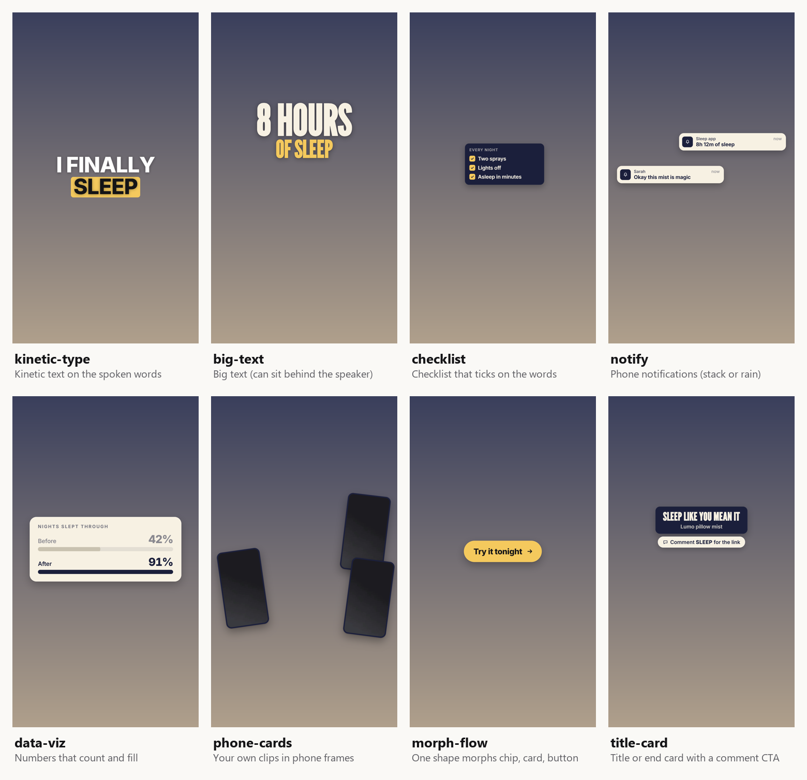
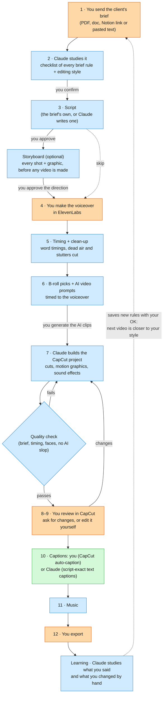
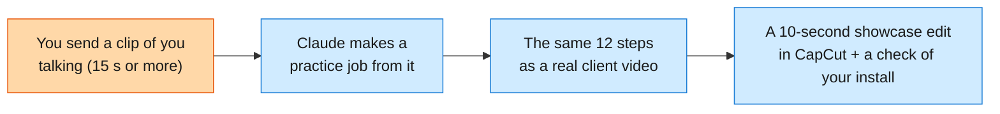
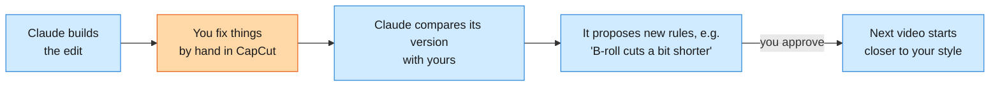

# edit-mo-to

**Your AI video-editing partner for client ads.** Send it a client's brief, and it writes the script, plans every shot, writes the AI video prompts, and **builds the CapCut project for you**: clean cuts, motion graphics, sound effects and music. You review, tweak and export. It learns your style from every video, so each one needs fewer fixes.

Made for UGC ads, B-roll ads, claymation, Pixar-style stories and TikTok product ads. Runs inside the Claude desktop app (Claude Code).


<sub>A few of its 40+ motion graphics, in a made-up brand's colours. Every video gets the colours and fonts of its own client.</sub>

## What you need

| | |
|---|---|
| **Claude** | the Claude desktop app with a paid plan (Pro works; Max if you edit every day) |
| **CapCut** | CapCut desktop (tested with version 9.6) |
| **A computer** | Windows or Mac, with about 2 GB free |
| **Time** | about 30 minutes to install, once |

You don't need to know any code. Claude installs everything else for you and asks before each step.

## How a video gets made

Orange steps are yours; blue steps are Claude's; green steps are either, your choice. Claude **stops and waits** at every step that needs your answer, and nothing moves on until you reply.



## Step 1 · Install (one copy-paste)

1. Install the **Claude** desktop app and sign in.
2. Open the **Code** tab and start a new session (any folder is fine).
3. Copy this prompt, paste it in, and press Enter:

```text
Set up the edit-mo-to video workflow on this computer for me. I'm a beginner, so explain each
step in one simple line, ask me before installing anything, and stop to tell me whenever
something needs me (a login, a restart, or installing CapCut).

1. Check this computer and install what's missing: Git, Node.js 22 or newer, Python 3.12, and
   ffmpeg (on Windows: winget install Gyan.FFmpeg). Ask me to install CapCut desktop myself
   if it's missing.
2. Ask me which folder to keep my videos in (suggest "D:\Video Editing" on Windows or
   "~/Video Editing" on Mac). Clone https://github.com/jushuaaang/edit-mo-to.git into it.
   If the folder already has files, use git init, git remote add origin and git pull
   origin main inside it instead.
3. Open that folder's README.md and follow its "Manual setup" section for this computer
   (Windows or Mac): the Python tools, HyperFrames, the CapCut backend and its MCP server,
   and a machine.json with this computer's paths.
4. Run the test suite and tell me in plain words what passed and what didn't.
5. Finish by telling me to practise with /practice-muna (I'll send a clip of me
   talking), then how to start my first real video.
```

Afterwards, always start Claude Code **in your video folder** (for example `D:\Video Editing`).

**The app.** When you type `/edit-mo-to` or `/practice-muna`, Claude also opens **Edit Mo To**, a companion app, in the browser pane (or your browser). It shows each video's 12 steps, Claude's questions with buttons to answer them, the tables and prompts with Copy buttons, and the storyboard. The chat keeps working too: answer in whichever you like.

## Step 2 · Practise first: `/practice-muna`

"Practice muna" = practise first. Before your first client, do one practice run on a clip of yourself:



Type **`/practice-muna`** and send the clip. Every stop shows a suggested answer (just accept it) and a one-line tip on what happens in a real job. It takes about 15–25 minutes, and you finish knowing the whole workflow.

Or press **Start practice** on the app's dashboard: it opens Terminal (Mac) or a command window (Windows) with Claude already running `/practice-muna` in your Video Editing folder.

## Step 3 · Your first real video

1. Start a Claude Code session in your video folder.
2. Make a folder for the video inside it (for example `D:\Video Editing\Glow Serum`) and put the client's files there.
3. Type **`/edit-mo-to`** and paste or attach the brief. Say which folder you made.
4. Answer each stop. Tip: put what you already know in your first message (B-roll source, AI tool, voiceover file), and Claude skips those questions.
5. When the script is ready, Claude asks **"Storyboard first?"** Say yes for a new client or an AI-heavy ad: you see every shot and graphic before any video is generated.
6. When the project is built, **quit CapCut completely** before asking for changes (CapCut overwrites projects when it closes). Then review it, and ask for changes or edit it yourself.
7. Captions: run CapCut's auto-caption yourself, or let Claude add simple text captions (the script's exact words, a pop-in; for an animated look use CapCut's caption presets). Then pick the music, and export. A script that is not English or Filipino carries a temporary English track, `TEMP_EN_delete_me`, so you can follow it while reviewing: delete it before export.

### What a stop looks like

```text
Claude:  Here's everything the brief requires (8 rules). Anything missing or wrong?
You:     Looks right.
Claude:  Use the client's B-roll, generate AI video, or both?
You:     Client B-roll.
```

Lists and plans come as tables in the chat. Times are written `seconds:frames`: `7:12` means 7 seconds and 12 frames.

## It learns how *you* edit



After each video, Claude looks at what you trimmed, moved, deleted or added, what you made louder or quieter, and every correction you typed. Habits that repeat become rules, and **only the ones you approve are saved**.

- **Your rules are yours:** they're saved in `.claude/edit-mo-to/my-preferences.md` on your computer and never uploaded. Everyone starts from the same shared starter rules (`preferences.md`); your own rules win where they differ.
- **Client notes also stay on your computer** (`.claude/edit-mo-to/clients/`).
- **Using a second computer?** Copy `my-preferences.md` and the `clients/` folder over.

## Words you'll see

| Word | Meaning |
|---|---|
| **Stop** (⛔) | Claude asks you something and waits for your answer |
| **Brief** | the client's instructions for the video |
| **A-roll** | the main footage: the person talking |
| **B-roll** | footage shown over the voice: product shots, hands, places |
| **VO** | voiceover: the spoken audio (often made in ElevenLabs) |
| **Storyboard** | a page showing every planned shot and graphic before anything is made |
| **Timeline** | one version of the edit inside the CapCut project (each hook gets its own) |
| **Overlay / motion graphic** | animated text or cards placed on top of the video |
| **Cutout** | the speaker cut out of the background, so text can sit *behind* them |
| **QA** | Claude's quality check: brief rules, timing, faces clear, no AI-looking mistakes |

## Usage limits

Claude plans have a usage limit that resets every 5 hours. One measured example on the **Pro** plan: a `/practice-muna` run (a 10-second video, with two quality-fix rounds) used about **13%** of the 5-hour limit. A full client video uses much more. To stretch your limit:
- start a **new Claude session for each video**;
- answer several stops in one message;
- skip the storyboard for repeat clients.

## If something goes wrong

| Problem | Fix |
|---|---|
| Claude says CapCut is open | Quit CapCut completely (check the system tray), then tell Claude to continue |
| "Backend is down" or port 9001 errors | Tell Claude "start the CapCut backend"; it knows how |
| `/edit-mo-to` or `/practice-muna` doesn't show up | Start the Claude Code session in your video folder, not somewhere else |
| Graphics fail to render | Check your internet connection (graphics load their fonts online), then retry |
| Want the newest templates and fixes | Tell Claude "update edit-mo-to" (a safe `git pull`; your own rules and client notes are never touched) |

<details>
<summary><b>For the technically curious: what's inside, manual setup, updates</b></summary>

### What's inside
| Path | What |
|---|---|
| `CLAUDE.md` | house rules Claude reads in this folder |
| `.claude/skills/edit-mo-to/` | the `/edit-mo-to` skill: 12 gated steps, plus step detail and the learning step |
| `.claude/agents/` | ugc, broll, claymation, pixar, product-ad (style), editor (CapCut builds), qa (checks), motion-designer (new looks and templates) |
| `.claude/edit-mo-to/preferences.md` | shared starter rules everyone begins with |
| `.claude/edit-mo-to/my-preferences.md` | your own learned rules (local only, gitignored; wins over the starter rules) |
| `.claude/edit-mo-to/edit-patterns.jsonl` | your log of hand-edit patterns per video (local only, gitignored) |
| `.claude/edit-mo-to/clients/` | per-client notes |
| `.claude/edit-mo-to/style-agent-contract.md` | edit-plan format shared by the agents |
| `.claude/edit-mo-to/motion/` | 40+ HyperFrames motion templates (incl. receipt printer, odometer, live markup, comment CTA, eyedropper palette, film strip), `CATALOGUE.md`, `sfx/` (19 Pixabay-licence sounds), `sfx_defaults.json` |
| `.claude/edit-mo-to/tools/` (fast path) | `plan_tools.py` (compact plans and prompts: expand, check, prompt text, revision patch ops), `build_project.py` (whole CapCut project in one run, temporary English track, music drafts, step-10 captions), `captions.py` (caption chunks from the script and VO word timings, temporary English rows), `qa_check.py` (mechanical build, caption and prompt QA), `sheets.py` (tiled frame sheets, B-roll inventory), `context_pack.py` (only the rules one agent needs), `learn.py` (learning step: new rules only, declined ones remembered), `plan_common.py` (shared plan helpers) |
| `.claude/edit-mo-to/tools/` | `capcut_project.py` (CapCut projects), `media_timing.py` (word timings, beats), `speech_cuts.py` (dead-air and mistake cuts, from Herk Edit Kit, MIT), `storyboard.py` (storyboard page), `qc_clips.py` (batch QC of generated clips), `motion_render.py` (motion graphics, speaker cutout), `plan_build.py` / `plan_preview.py` (frame plans, checks, preview), `edit_diff.py` (learns from hand edits), `rehearse.py` (`/practice-muna` jobs), `playbook_scan.py` (Playbook folder scans), `machine.py` (per-computer paths) + tests |
| `.claude/edit-mo-to/gui/`, `.claude/edit-mo-to/run` | the Edit Mo To companion app (local server and pages), and the launcher Claude runs every workflow script through |
| `.claude/edit-mo-to/setup/capcut-start.mjs` | launcher that auto-starts the CapCut backend for the MCP server |
| `docs/` | design doc and build plan |

### Manual setup

The install prompt in Step 1 follows these steps for you. They're here if you'd rather do it by hand, or need to fix something.

#### Windows

1. **Install:**
   - CapCut desktop (tested with 9.6);
   - Node.js 22+;
   - Python 3.12;
   - Git;
   - ffmpeg with ffprobe on PATH (`winget install Gyan.FFmpeg`);
   - Claude Code.
2. **Clone this repo as the workflow folder:**
   ```
   git clone https://github.com/jushuaaang/edit-mo-to.git "D:\Video Editing"
   ```
   If the folder already holds client footage, run `git init`, `git remote add origin <url>` and `git pull origin main` inside it instead. `.gitignore` keeps the footage out.
3. **Tools (Python):**
   ```
   cd "D:\Video Editing\.claude\edit-mo-to\tools"
   python -m venv .venv
   .venv\Scripts\python -m pip install -r requirements.txt
   ```
4. **HyperFrames (Node, pinned 0.8.162):**
   ```
   cd "D:\Video Editing\.claude\edit-mo-to\motion"
   npm ci
   ```
5. **CapCut backend + MCP server**, in `%USERPROFILE%\mcp-servers`:
   ```
   git clone https://github.com/sun-guannan/VectCutAPI.git            (tested at 269a404)
   git clone https://github.com/MigueDuque/capcut-mcp-server-extended.git   (tested at a3aa1fd)
   cd VectCutAPI
   python -m venv .venv
   .venv\Scripts\python -m pip install -r requirements.txt
   copy config.json.example config.json
   cd ..\capcut-mcp-server-extended
   npm install
   copy "D:\Video Editing\.claude\edit-mo-to\setup\capcut-start.mjs" "%USERPROFILE%\mcp-servers\capcut-start.mjs"
   claude mcp add capcut --scope user -e CAPCUT_API_URL=http://localhost:9001 -- node "%USERPROFILE%\mcp-servers\capcut-start.mjs"
   ```
   **VectCutAPI patch (all OSes):** at 269a404, `add_video` fails on the second clip when the draft has only one video track, which is what happens when the A-roll sits on CapCut's main track. In `add_video_track.py` (line 87) and `add_image_impl.py` (line 96), change `except NameError:` to `except (NameError, StopIteration):`.
6. **Machine paths:** copy `.claude/edit-mo-to/machine.example.json` to `machine.json` and fill in this computer's paths (see "Machine paths" below).
7. **Check:**
   ```
   cd "D:\Video Editing\.claude\edit-mo-to\tools"
   .venv\Scripts\python -m pytest tests -q
   ```
   The CapCut tests need the backend running on port 9001.

##### Windows: speed settings
- **Defender exclusions (one time, optional).** Real-time scanning of the build area and the Python venv slows every build. Run this once in PowerShell **as administrator** yourself (Claude does not change security settings), with your paths from `machine.json` in place of `{tmp}` and `{root}` (`python3 .claude/edit-mo-to/tools/machine.py` prints them):
  ```
  Add-MpPreference -ExclusionPath "{tmp}","{root}\.claude\edit-mo-to\tools\.venv"
  ```
  Check with `Get-MpPreference | select -Expand ExclusionPath`. Not measured on the reference PC (needs admin).
- **Speech on older NVIDIA cards.** On a GTX 9xx card, `faster-whisper` sees the GPU but has no float16 and `cublas64_12.dll` is missing, so the CUDA load fails and it falls back to CPU. Set `"asr_device": "cpu"` in `machine.json` to skip the failed attempt, or install the CUDA 12 libraries (cuBLAS and cuDNN 9) and keep `auto`. `"cuda"` forces the GPU and errors if it cannot load.
- **`machine.json` keys for speed:** `asr` (`faster-whisper` or `mlx`), `asr_device` (`auto`, `cpu`, `cuda`), `render_workers` (HyperFrames `--workers` per overlay render, default 1), `render_concurrency` (overlay renders side by side, default `min(4, cores / 2)`). Reference PC (i7-3770K, GTX 970): `"asr": "faster-whisper", "asr_device": "cpu", "render_workers": 1, "render_concurrency": 4`.
- **Starting VectCutAPI.** It must run with `PYTHONIOENCODING=utf-8`, otherwise any keyframe returns an empty draft with `success: true` (a Chinese status line crashes on the Windows console encoding). `capcut-start.mjs`, the launcher the `capcut` MCP server runs, now sets it when it starts the backend. If you installed it earlier, copy the updated file over the old one, then stop the running backend (`pythonw.exe` listening on port 9001, in Task Manager) and restart Claude Code, or say "start the CapCut backend":
  ```
  copy "D:\Video Editing\.claude\edit-mo-to\setup\capcut-start.mjs" "%USERPROFILE%\mcp-servers\capcut-start.mjs"
  ```
  If you start it by hand instead: `set PYTHONIOENCODING=utf-8`, then `.venv\Scripts\pythonw.exe capcut_server.py` in `VectCutAPI`.

#### Mac

Same steps as Windows, with these differences:
- Install with Homebrew: `brew install node python@3.12 ffmpeg gh`, plus CapCut desktop and Claude Code.
- Clone to `~/Video Editing`. Create venvs with `python3.12 -m venv .venv` and use `.venv/bin/python` wherever Windows uses `.venv\Scripts\python`.
- `capcut-start.mjs` picks the right venv path on either OS.
- CapCut drafts live in `~/Movies/CapCut/User Data/Projects/com.lveditor.draft`.
- **VectCutAPI on macOS:** at the tested commit, `desktop_companion.py` loads Windows APIs on import, so the server won't start. In `~/mcp-servers/VectCutAPI`, run `git mv desktop_companion.py _desktop_companion_win.py`, then copy `.claude/edit-mo-to/setup/vectcut-desktop_companion-shim.py` to `desktop_companion.py`. Drafts save normally; only CapCut window auto-reload is off (the workflow uses `auto_deploy: false` anyway).
- The CapCut tests use `zapply/edited/hook2.mp4` and `for cloning.MP3` when present, and otherwise make synthetic stand-ins with ffmpeg in `{tmp}/_test_media`.

##### Machine paths
Each computer has its own untracked `.claude/edit-mo-to/machine.json` (copy `machine.example.json`): `root`, `python`, `tmp`, `mcp_servers`, `capcut_drafts`, plus the optional speed keys `asr`, `asr_device`, `render_workers`, `render_concurrency` (see "Windows: speed settings"). The Python tools read it through `tools/machine.py`; the skill and agents write these as `{root}`, `{python}`, `{tmp}` and `{capcut_drafts}`. Keys you leave out fall back to the platform default.

### The app (Edit Mo To)
The app runs on this computer only (`127.0.0.1`, port 4810, or `gui_port` in `machine.json`). Claude starts it for you, and restarts it when the app's code was updated or you changed a path or the port in Settings. To open the dashboard without a session, run this in your Video Editing folder (`{root}`) (on Windows, in Git Bash):
```
.claude/edit-mo-to/run gui/launch.py --open
```

**What Claude may run without asking.** The workflow ships `.claude/settings.json`, which pre-approves one command pattern: `Bash(.claude/edit-mo-to/run *)`. `run` starts only the workflow's own Python scripts in `.claude/edit-mo-to/gui/` and `.claude/edit-mo-to/tools/`, with the tools' Python, and refuses anything else. Those scripts can do everything the workflow does with any arguments, including writing CapCut projects and `playbook_scan.py`'s reads of a shared Playbook folder over the network; no other shell command is pre-approved (no `rm`, no git, no curl). That is why an answer you give in the app carries on without a permission question in chat. Your own `.claude/settings.local.json` is never changed.

### Getting updates
The repo holds the shared workflow only: tools, agents, templates and starter rules. Nothing personal is ever uploaded, and Claude never pulls or pushes on its own. To get the newest version, tell Claude "update edit-mo-to": it runs `git pull --ff-only`, which never touches your `my-preferences.md`, client notes or videos.

</details>
