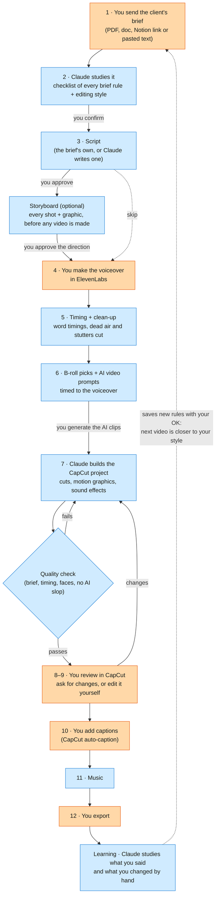

# edit-mo-to

An AI video-editing partner for client ads, running in **Claude Code**. You give it the client's brief; it writes the script, plans the B-roll, writes the AI video prompts, and **builds the CapCut project for you**, with motion graphics, sound effects and clean cuts. You review, tweak and export. It learns your style from every video, so each one needs fewer fixes.

Made for UGC ads, B-roll ads, claymation, Pixar-style stories and TikTok product ads.

## How it works

Orange steps are yours; blue steps are Claude's. Claude stops at every step that needs your answer, and nothing moves on until you say so.



## Install on a new computer (one prompt)

1. Install the **Claude** desktop app and sign in (a paid plan; Max is best if you edit often).
2. Open the **Code** tab and start a new session (any folder is fine).
3. Copy this prompt, paste it in, and press Enter:

```text
Set up the edit-mo-to video workflow on this computer for me. I'm a beginner, so explain each
step in one simple line, ask me before installing anything, and stop to tell me whenever
something needs me (a login, a restart, or installing CapCut).

1. Check this computer and install what's missing: Git, Node.js 22 or newer, Python 3.12, and
   ffmpeg (on Windows: winget install Gyan.FFmpeg). Ask me to install CapCut desktop myself
   if it's missing.
2. Ask me which folder to keep my videos in (suggest "D:\Video Editing" on Windows or
   "~/Video Editing" on Mac). Clone https://github.com/jushuaaang/edit-mo-to.git into it.
   If the folder already has files, use git init, git remote add origin and git pull
   origin main inside it instead.
3. Open that folder's README.md and follow its "Manual setup" section for this computer
   (Windows or Mac): the Python tools, HyperFrames, the CapCut backend and its MCP server,
   and a machine.json with this computer's paths.
4. Run the test suite and tell me in plain words what passed and what didn't.
5. Finish by telling me to practise with /practice-muna (I'll send a clip of me
   talking), then how to start my first real video.
```

Setup takes about 15–30 minutes, mostly downloads. Afterwards, always start Claude Code **in your video folder**.

## Practise first: `/practice-muna`

Just installed? Do a practice run before a real client. Type **`/practice-muna`** ("practise first") and send any raw clip of someone talking to the camera (15 seconds or more, straight from a phone). Claude turns it into a practice job and walks you through **the same 12 steps as a real client video**: brief, checklist, script and storyboard, voiceover, clean-up, B-roll, the CapCut build with motion graphics, a review round, captions, music, export and the learning step. It's shrunk to a **10-second video**, so it takes about 15–25 minutes. At every stop you get a suggested answer and a one-line tip on what happens in a real job. You finish with a 10-second showcase edit, and it checks that every part of your install works.

## Your first video

1. In the Claude app's **Code** tab, start a session in your video folder (for example `D:\Video Editing`).
2. Make a folder for the video inside it (for example `D:\Video Editing\Glow Serum`) and put the client's files there.
3. Type **`/edit-mo-to`** and paste the brief, or attach it. Say which folder you made. Tip: if you already know them, add the B-roll source (client clips, AI or both), the AI tool (Google Flow or Seedance) and the voiceover file, and Claude skips those questions.
4. When the script is ready, Claude asks **"Storyboard first?"** Say yes for a new client or an AI-heavy ad: you get a storyboard page (every shot, with the real client footage and the real motion graphics) before any video is generated. Claude also gives you free Nano Banana image prompts for the AI shots; generate them in Google Flow if you want to see the real look, and those images become the start frames of the videos later.
5. Answer Claude's questions as they come. Each one is a stop sign: nothing happens until you reply.
6. When the project is built, **quit CapCut completely** before asking for changes (CapCut overwrites projects when it closes). Then open it, review, and either ask for changes ("make the hook faster", "swap clip 4") or edit it yourself.
7. Add captions with CapCut's auto-caption, tell Claude, pick the music, and export.

Good to know:
- **Deliverables appear in the chat as tables** (clip lists, prompts, plans), with times in `seconds:frames` (for example `7:12` = 7 seconds and 12 frames).
- **You always do captions and the export.** Claude never adds captions.
- **It never sends anything anywhere** or spends credits without asking you first.

## It learns how *you* edit

After each video, Claude compares the project as it built it with how you finished it in CapCut: which clips you trimmed, moved, deleted or added, which graphics you moved, and what you made louder or quieter. It also reads every correction you typed. Habits that repeat across videos become rules. Claude shows you the list and **saves only what you approve**, so the next video starts closer to your style.

- Your rules live in `.claude/edit-mo-to/preferences.md` (general) and `.claude/edit-mo-to/clients/` (per client).
- General rules sync through GitHub, so every computer you use shares them. **Client notes do not:** this repo is public, so `clients/` stays on each computer (it's in `.gitignore`). To use them on another computer, copy the folder over or keep it in a private cloud folder.
- **A different editor with their own taste** should use their own copy of this repo (a fork), so the two styles don't mix.

## What's inside
| Path | What |
|---|---|
| `CLAUDE.md` | house rules Claude reads in this folder |
| `.claude/skills/edit-mo-to/` | the `/edit-mo-to` skill: 12 gated steps, plus step detail and the learning step |
| `.claude/agents/` | ugc, broll, claymation, pixar, product-ad (style), editor (CapCut builds), qa (checks), motion-designer (new looks and templates) |
| `.claude/edit-mo-to/preferences.md` | everything learned about how the editor edits |
| `.claude/edit-mo-to/edit-patterns.jsonl` | log of hand-edit patterns per video (the learning step reads it) |
| `.claude/edit-mo-to/clients/` | per-client notes |
| `.claude/edit-mo-to/style-agent-contract.md` | edit-plan format shared by the agents |
| `.claude/edit-mo-to/motion/` | HyperFrames motion templates, `CATALOGUE.md`, `sfx/` (19 Pixabay-licence sounds), `sfx_defaults.json` |
| `.claude/edit-mo-to/tools/` | `capcut_project.py`, `media_timing.py`, `speech_cuts.py` (dead-air and mistake cuts, from Herk Edit Kit, MIT), `edit_diff.py` (learns from hand edits), `motion_render.py`, `plan_build.py`, `plan_preview.py` + tests |
| `.claude/edit-mo-to/setup/capcut-start.mjs` | launcher that auto-starts the CapCut backend for the MCP server |
| `docs/` | design doc and build plan |

## Manual setup

The install prompt above follows these steps for you. They're here if you'd rather do it by hand, or need to fix something.

### Windows

1. **Install:**
   - CapCut desktop (tested with 9.6);
   - Node.js 22+;
   - Python 3.12;
   - Git;
   - ffmpeg with ffprobe on PATH (`winget install Gyan.FFmpeg`);
   - Claude Code.
2. **Clone this repo as the workflow folder:**
   ```
   git clone https://github.com/jushuaaang/edit-mo-to.git "D:\Video Editing"
   ```
   If the folder already holds client footage, run `git init`, `git remote add origin <url>` and `git pull origin main` inside it instead. `.gitignore` keeps the footage out.
3. **Tools (Python):**
   ```
   cd "D:\Video Editing\.claude\edit-mo-to\tools"
   python -m venv .venv
   .venv\Scripts\python -m pip install -r requirements.txt
   ```
4. **HyperFrames (Node, pinned 0.8.162):**
   ```
   cd "D:\Video Editing\.claude\edit-mo-to\motion"
   npm ci
   ```
5. **CapCut backend + MCP server**, in `%USERPROFILE%\mcp-servers`:
   ```
   git clone https://github.com/sun-guannan/VectCutAPI.git            (tested at 269a404)
   git clone https://github.com/MigueDuque/capcut-mcp-server-extended.git   (tested at a3aa1fd)
   cd VectCutAPI
   python -m venv .venv
   .venv\Scripts\python -m pip install -r requirements.txt
   copy config.json.example config.json
   cd ..\capcut-mcp-server-extended
   npm install
   copy "D:\Video Editing\.claude\edit-mo-to\setup\capcut-start.mjs" "%USERPROFILE%\mcp-servers\capcut-start.mjs"
   claude mcp add capcut --scope user -e CAPCUT_API_URL=http://localhost:9001 -- node "%USERPROFILE%\mcp-servers\capcut-start.mjs"
   ```
6. **Machine paths:** copy `.claude/edit-mo-to/machine.example.json` to `machine.json` and fill in this computer's paths (see "Machine paths" below).
7. **Check:**
   ```
   cd "D:\Video Editing\.claude\edit-mo-to\tools"
   .venv\Scripts\python -m pytest tests -q
   ```
   The CapCut tests need the backend running on port 9001.

### Mac

Same steps as Windows, with these differences:
- Install with Homebrew: `brew install node python@3.12 ffmpeg gh`, plus CapCut desktop and Claude Code.
- Clone to `~/Video Editing`. Create venvs with `python3.12 -m venv .venv` and use `.venv/bin/python` wherever Windows uses `.venv\Scripts\python`.
- `capcut-start.mjs` picks the right venv path on either OS.
- CapCut drafts live in `~/Movies/CapCut/User Data/Projects/com.lveditor.draft`.
- **VectCutAPI on macOS:** at the tested commit, `desktop_companion.py` loads Windows APIs on import, so the server won't start. In `~/mcp-servers/VectCutAPI`, run `git mv desktop_companion.py _desktop_companion_win.py`, then copy `.claude/edit-mo-to/setup/vectcut-desktop_companion-shim.py` to `desktop_companion.py`. Drafts save normally; only CapCut window auto-reload is off (the workflow uses `auto_deploy: false` anyway).
- The CapCut tests use `zapply/edited/hook2.mp4` and `for cloning.MP3` when present, and otherwise make synthetic stand-ins with ffmpeg in `{tmp}/_test_media`.

### Machine paths
Each computer has its own untracked `.claude/edit-mo-to/machine.json` (copy `machine.example.json`): `root`, `python`, `tmp`, `mcp_servers`, `capcut_drafts`. The Python tools read it through `tools/machine.py`; the skill and agents write these as `{root}`, `{python}`, `{tmp}` and `{capcut_drafts}`. Keys you leave out fall back to the platform default.

## Keeping computers in sync
Rules and templates change as the workflow learns (client notes stay on each computer).
- **Before starting a video:** Claude runs `git pull` for you.
- **After the learning step:** Claude commits and pushes the new rules. If the push is blocked, it gives you the command to run.
